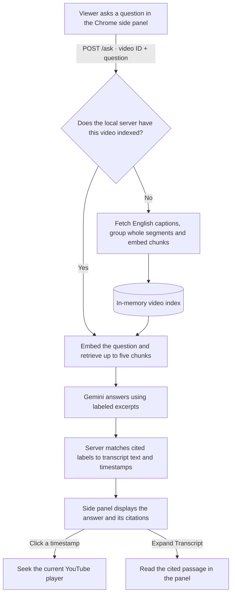

<h1 align="center"> AskTube</h1>

<p align="center">
  
  
  
  
  
  
</p>

<p align="center">
  Ask questions about a YouTube video while you watch. AskTube answers from the video’s English captions in a Chrome side panel. Click a timestamp to replay the passage, or expand **Transcript** to read the speaker’s exact words.
<p>


## 🚀 Quick start

You’ll need desktop Chrome 116+, Node.js and npm (developed on Node 24), and a Gemini API key with access to the models below. Get a key from [Google AI Studio](https://aistudio.google.com/apikey).

```sh
git clone https://github.com/joydeep-devx/asktube.git
cd asktube
npm ci
```

1. **🔑 Configure Gemini.** Create `.env` beside `package.json` and add `GOOGLE_API_KEY=your_gemini_api_key_here`.
2. **🖥️ Start the server.** Run `npm run server`. Keep the terminal open while using the extension. The API listens at `http://127.0.0.1:4317`.
3. **🧩 Load the extension.** Open `chrome://extensions`, enable **Developer mode**, click **Load unpacked**, and select the [extension folder](extension/).
4. **💬 Ask a question.** Open a YouTube video or Short with English captions, click **AskTube** in Chrome’s extensions menu, then type a question or choose **Summarize this video**.

## ⏱️ Follow a citation

A reference like **[1]** points to a row below the answer. Click **▶ 1:12 – 1:38** to jump to the start of that passage. Click **Transcript ⌄** to read it without moving the player. Each range covers a group of captions, so playback may start a little before the cited sentence.

## ⚙️ How it works



The splitter targets 1,000 characters per chunk with up to 200 characters of overlap. It keeps whole caption segments together so each passage retains its original time range.

**🔒 Data and privacy.** The panel sends the video ID and question to your local server. Google receives caption chunks and questions for embeddings, and the chat model receives the question and retrieved excerpts. Your API key stays on the server. Up to eight video indexes stay in memory until eviction or restart. The panel groups chats by video, and each question is retrieved independently.

## 🛠️ Under the hood

| Component | Built with |
| --- | --- |
| [Chrome side panel](extension/) | HTML5, CSS and JavaScript · Chrome Manifest V3 and the Side Panel API |
| [Local API](src/server.js) | Node.js · HTTP server, ES modules and dotenv |
| [Video retrieval chain](src/rag/videoChain.js) | LangChain.js · `youtube-transcript-plus` and `MemoryVectorStore` |
| Gemini models | Google Gemini · `gemini-embedding-001` for retrieval and `gemini-3.5-flash-lite` for answers |

## 🔧 Development

| Command | Purpose |
| --- | --- |
| `npm run server` | Start the extension API in watch mode. |
| `npm start` | Run the standalone video Q&A demo in `src/index.js`. |
| `node --test src/modules/youtube/youtubeUtils.test.js` | Run the YouTube URL parsing tests. |

After editing the panel, click **Reload** in `chrome://extensions` and reopen AskTube. If a question fails, check the local server, the video’s English captions, and your Gemini key’s model access.

**📄 License** · [MIT](LICENSE)
